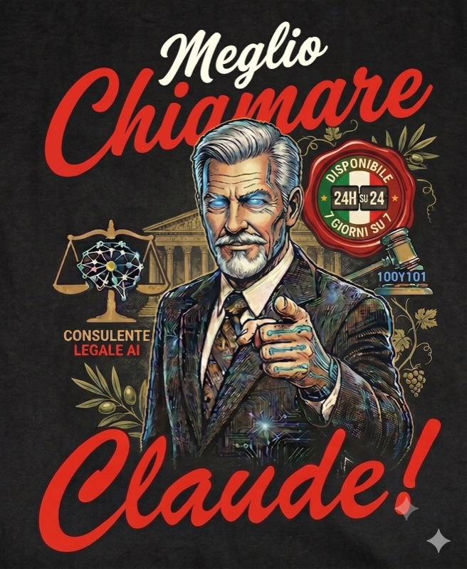

  

<strong>Marketplace — BetterCallClaude Italia</strong>

Marketplace per l'installazione del plugin **BetterCallClaude Italia** su Cowork Desktop.

Il plugin offre intelligenza legale italiana — ricerca sui precedenti della Cassazione, strategia di causa, redazione legale, verifica delle citazioni e flussi di lavoro personalizzati in tutte le 20 regioni italiane, con protezione integrata del segreto professionale (Art. 622 CP + L. 247/2012).

**21 agenti · 30 comandi · 17 skill · 9 server MCP**

---

## Novità della v2.4.0

- **Gate ollama locale opzionale** — il plugin ora include il wrapper locale `mllama` (wrapper MCP STDIO con 5 tool: `ollama_check_status`, `ollama_generate`, `ollama_chat`, `ollama_classify_privacy` offline, `ollama_list_models`); la presenza o assenza del daemon è una scelta dell'avvocato — se non installi Ollama, il wrapper resta esente dall'hook privacy ma i tool restituiscono errore di connessione, il plugin continua a funzionare con i 9 server remoti. Classificatore offline portato dai pattern dell'hook privacy (Art. 622 CP, L. 247/2012, CDF Art. 13 + 28, Art. 200/103 CPP). I tool `mcp__ollama__*` sono sempre esenti in tutte le modalità.
- **`/doctor` riconosce Ollama** — nuovo step opzionale (non-bloccante): prova `ollama_check_status` e riporta "online (N modelli)" oppure "non attivo — avvia `ollama serve`"; non entra nel conteggio 8/9 dei server remoti.

## Novità della v2.3.0

- **Agenti operativi su ogni installazione** — le whitelist `tools:` di tutti i 68 file (21 agenti, 30 comandi, 17 skill) ora includono ogni tool MCP sotto **entrambe** le convenzioni di denominazione (`mcp__plugin_bettercallclaude-italia_<server>__<tool>` e `mcp__<server>__<tool>`): sulle installazioni Cowork che registrano i connettori senza prefisso plugin, gli agenti prima fallivano ogni chiamata ai database legali ("No such tool available").
- **I panel del briefing girano davvero** — `/briefing` ora possiede il dispatch del panel via `Task` nella sessione top-level (dove funziona su ogni host); il coordinatore diventa un planner puro (classificazione + roster in Fase A, piano in Fase D). Prima il dispatch annidato degradava silenziosamente in modalità single-agente.
- **`/doctor` rileva la route agent** — nuovo Passo 3: dispatcha lo specialista citazioni via `Task` per una chiamata one-shot a `legal-citations-ita_validate`; se la route agent è rotta lo dice chiaramente invece di riportare tutto verde.
- **Guard CI di parity** — nuovo `scripts/check-tool-names.js` + step CI: ogni voce MCP nei frontmatter deve esistere in entrambe le convenzioni, perché questa classe di regressione non torni in silenzio.
---

## Installazione

1. In Cowork, clicca **Personalizza** > **Sfoglia plugin** > **Personali** > **+** > **Aggiungi marketplace da GitHub**
2. Inserisci `fedec65/bettercallclaude_italia` e clicca **Sincronizza**
3. Clicca **Installa** sulla scheda BetterCallClaude Italia

I server MCP si connettono automaticamente via HTTP. Nessuna configurazione manuale richiesta per i server remoti.

> **[QUI L'INSTALLAZIONE PASSO PER PASSO](bettercallclaude_italia/docs/INSTALLAZIONE.md)** -- Guida illustrata con screenshot per ogni passaggio.

---

## Documentazione

📖 [README completo del plugin](bettercallclaude_italia/README.md)

🔐 [Come accedere al server della Cassazione?](bettercallclaude_italia/docs/cassazione-cookie.md)

---

## Licenza

[AGPL-3.0](LICENSE)

[Supporta il progetto](https://buymeacoffee.com/federicocesconi)
