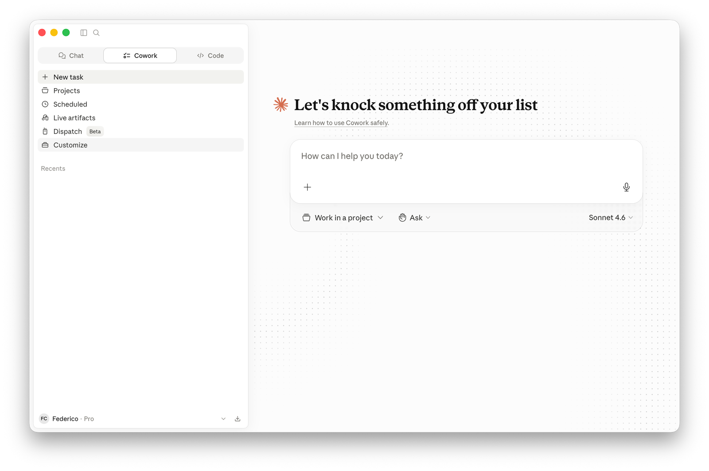
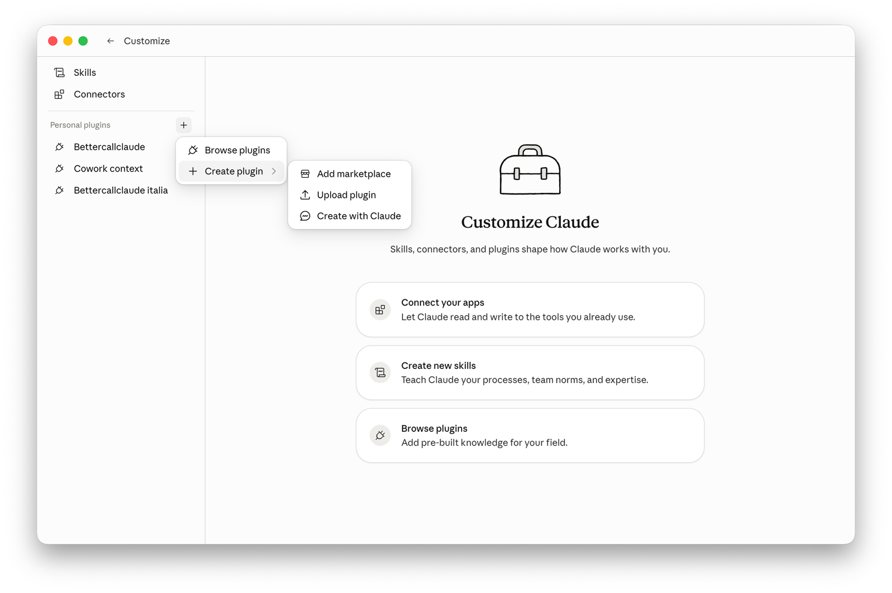
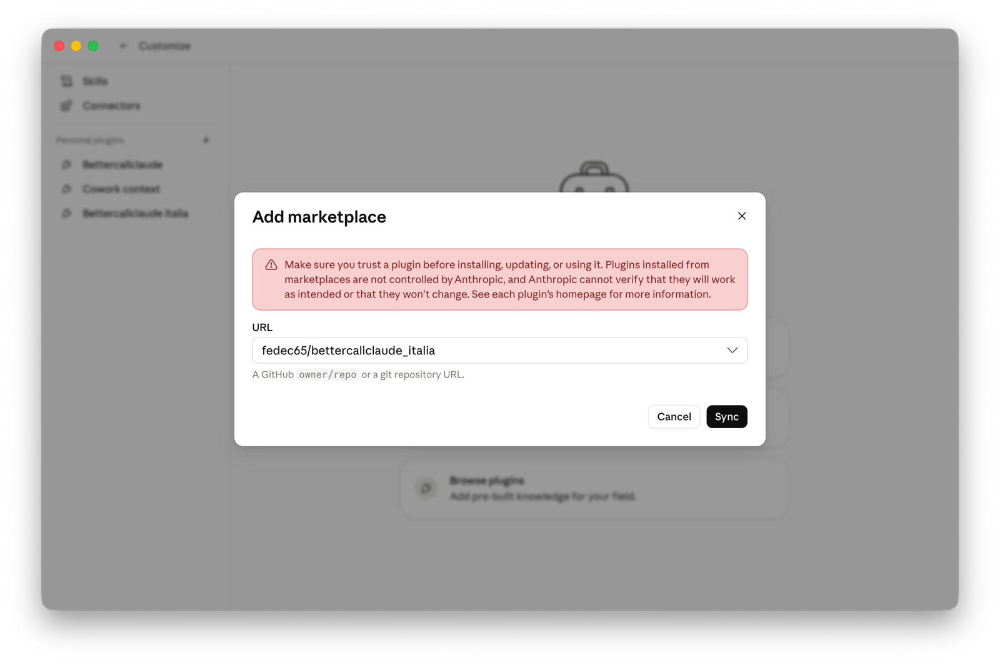
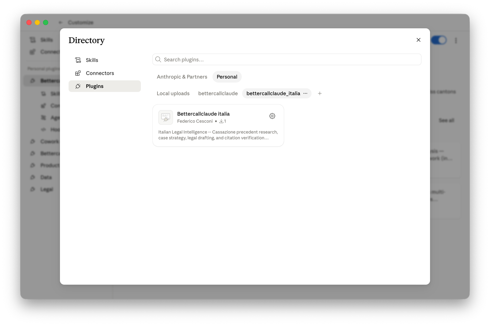
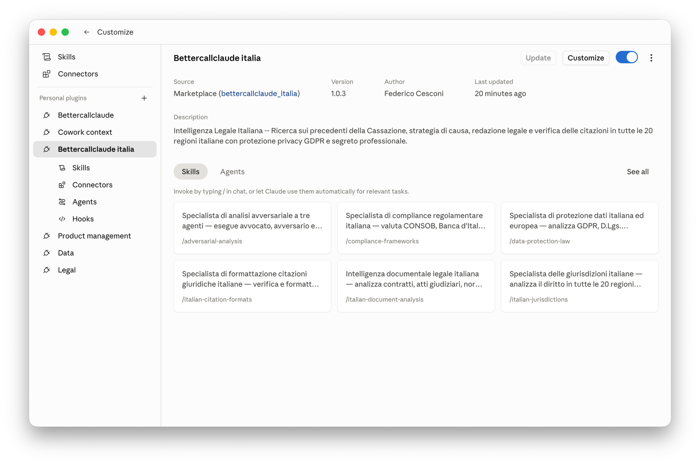
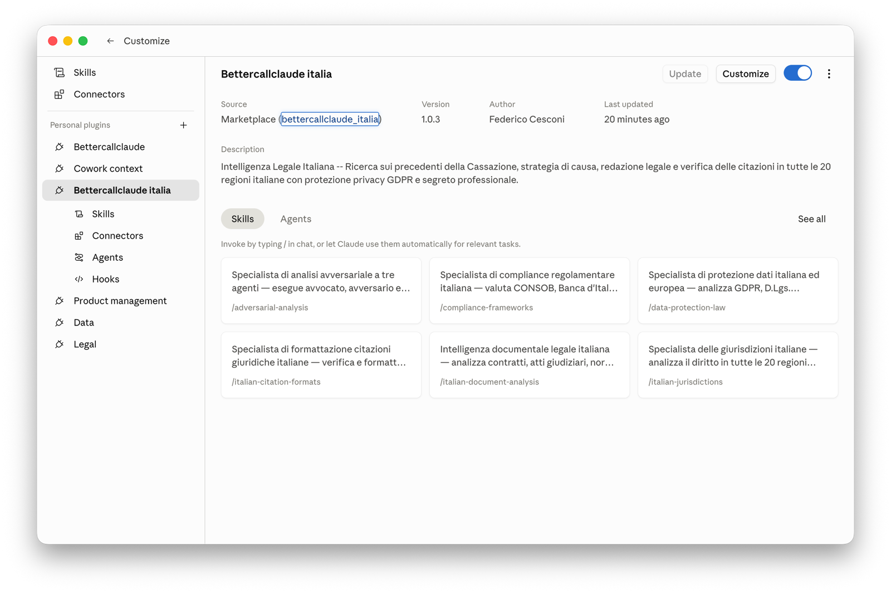
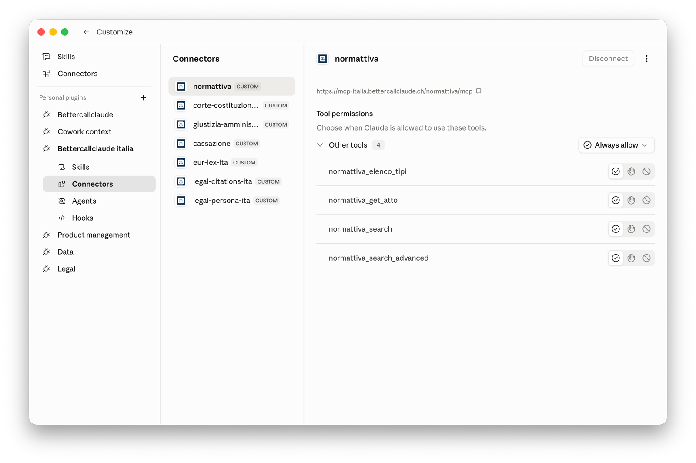
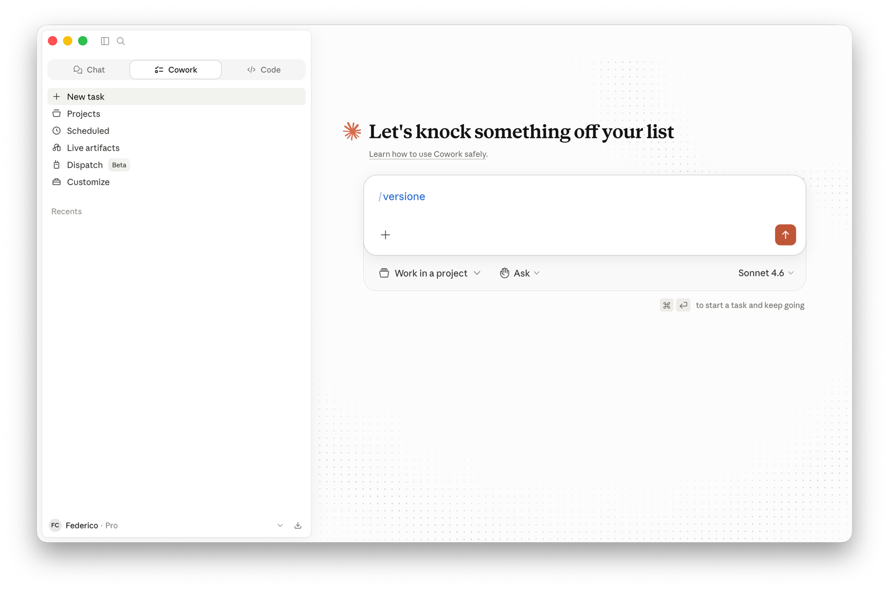
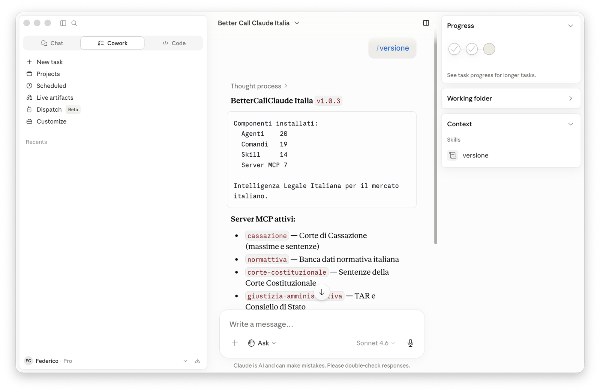
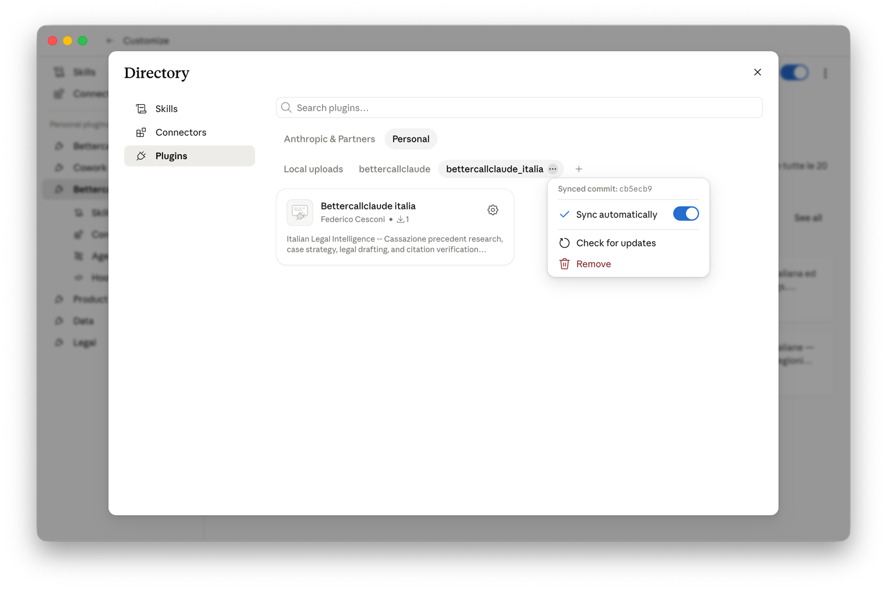

# Guida all'Installazione Passo per Passo

Questa guida ti accompagna nell'installazione di **BetterCallClaude Italia** su Claude Cowork Desktop.

---

## Prerequisiti

- [Claude Cowork Desktop](https://claude.ai) installato e funzionante
- Account Claude attivo (Piano Pro o superiore)

---

## Passo 1: Apri Customize

In Claude Cowork, clicca su **Customize** nella barra laterale sinistra.

---

## Passo 2: Aggiungi Marketplace

Clicca il pulsante **+** accanto a "Personal plugins", poi seleziona **Create plugin** > **Add marketplace**.

---

## Passo 3: Sincronizza il Repository

Inserisci `fedec65/bettercallclaude_italia` nel campo URL e clicca **Sync**.

---

## Passo 4: Installa il Plugin

Il marketplace e' stato aggiunto. Clicca sulla scheda **Bettercallclaude italia** per installarlo.

---

## Passo 5: Configura il Plugin

Una volta installato, clicca sull'icona della **ruota dentata** per accedere alle impostazioni del plugin.

---

## Passo 6: Attiva i Connectors

Nella pagina del plugin, clicca su **Connectors** nella barra laterale. Vedrai i 9 server MCP disponibili:

- **normattiva** -- Banca dati normativa italiana
- **corte-costituzionale** -- Sentenze della Corte Costituzionale
- **giustizia-amministrativa** -- TAR e Consiglio di Stato
- **cassazione** -- Massime e sentenze della Corte di Cassazione
- **eur-lex-ita** -- Atti UE in italiano
- **legal-citations-ita** -- Validazione citazioni giuridiche
- **legal-persona-ita** -- Redazione documenti e calcolo termini processuali
- **citation-verify-ita** -- Verifica esistenza citazioni giuridiche
- **workflows-ita** -- Flussi di lavoro personalizzati

---

## Passo 7: Dai i Permessi ai Connectors

Per ogni connector, seleziona **Always allow** per autorizzare Claude a utilizzare i tool automaticamente. Questo evita richieste di conferma ad ogni chiamata.

---

## Passo 8: Verifica l'Installazione

Torna in Claude Cowork e digita il comando `/versione` nella chat.

---

## Passo 9: Conferma

Claude Cowork ti mostrera' la versione installata di BetterCallClaude Italia con tutti i componenti e i server MCP disponibili.

---

## Passo 10: Attiva la Sincronizzazione Automatica

Per ricevere gli aggiornamenti del plugin in modo automatico, vai in **Customize** > **Browse plugins** > **Personal** > clicca sui tre puntini (**...**) accanto a **bettercallclaude_italia** e assicurati che il toggle **Sync automatically** sia attivato (blu). In questo modo, ogni volta che viene pubblicata una nuova versione del plugin, Cowork la scarichera' automaticamente senza intervento manuale.

---

## Ollama Locale (Opzionale)

Il plugin include un wrapper MCP locale (`ollama`) per elaborare contenuti soggetti a segreto professionale interamente on-premise, senza trasmetterli ai server remoti. È opzionale: senza Ollama installato il plugin funziona regolarmente con i 9 server MCP remoti e i tool `ollama_*` restituiscono solo un errore di connessione.

Per attivarlo:

1. Installa Ollama da [https://ollama.com](https://ollama.com)
2. Avvia il daemon: `ollama serve` (su macOS l'app desktop lo avvia automaticamente)
3. Scarica almeno un modello, ad esempio: `ollama pull llama3`

Modelli consigliati: `llama3` (uso generale), `qwen2.5` (bilingue IT/EN), `mixtral` (drafting lungo), `nomic-embed-text` (embedding).

I 5 tool (`ollama_check_status`, `ollama_generate`, `ollama_chat`, `ollama_classify_privacy`, `ollama_list_models`) sono sempre esenti dall'hook privacy in ogni modalità; `ollama_classify_privacy` funziona anche senza daemon (classificazione offline con gli stessi pattern dell'hook). L'host si configura con la variabile d'ambiente `OLLAMA_HOST` (default `http://localhost:11434`).

**Host remoto**: l'esenzione privacy vale perché l'elaborazione resta locale. Se `OLLAMA_HOST` punta a un host non-loopback (es. un server Ollama sulla LAN dello studio), il wrapper rifiuta di partire a meno di consenso esplicito: imposta `OLLAMA_ALLOW_REMOTE=1`. Senza questa variabile, un host remoto viene trattato come errore di configurazione — il contenuto privilegiato non deve lasciare la macchina per inadempienza.

---

## Problemi Comuni

| Problema | Soluzione |
|----------|-----------|
| "Marketplace sync failed" | Verifica di aver inserito correttamente `fedec65/bettercallclaude_italia` |
| I connectors non rispondono | Controlla la connessione internet. I server sono su `mcp-italia.bettercallclaude.ch` |
| `/doctor` segna tutti i server (0/9) come "non connesso" | Vedi sezione sotto — quasi sempre e l'ambiente sbagliato, non un guasto |
| Comandi non riconosciuti | Assicurati che il plugin sia attivo (toggle blu nella pagina del plugin) |

### "Non connesso" su tutti i 9 server (0/9)

Se `/doctor` segnala **tutti** i server come non connessi, il problema quasi mai e un guasto: e l'**ambiente** in cui stai usando il plugin.

- I 9 connettori MCP sono server HTTP remoti che il plugin registra solo negli ambienti che supportano i MCP server dei plugin: **Claude Cowork Desktop** e **Claude Code**.
- Nella **chat web/mobile di claude.ai** i connettori del plugin **non compaiono**: `/doctor` riportera' sempre 0/9, perche' l'ambiente non li carica affatto. Non e un malfunzionamento del plugin: i 9 server funzionano regolarmente in Cowork Desktop / Claude Code.
- **Cosa fare**: apri Claude Cowork Desktop (o Claude Code), verifica che il plugin sia installato e attivo, e rilancia `/bettercallclaude-italia:doctor` da li. Se in Cowork Desktop persiste 0/9 dopo un riavvio, controlla la connessione internet e che i permessi dei connectors (Passo 7) siano su "Always allow".
- **Importante — gateway vs ambiente**: se in Cowork Desktop / Claude Code vedi 0/9 **e** `/doctor` segnala anche il gateway come non raggiungibile, non e l'ambiente: e connessione, firewall o gateway down (controlla internet e riprova). Il caso "ambiente" vale solo quando il resto funziona ma i tool dei 9 server proprio non esistono (tipico della chat web/mobile).
- **Se invece ALCUNI server funzionano e altri no**: distinguere due casi. (1) I tool compaiono ma le chiamate falliscono → quasi sempre protezione anti-bot del portale specifico (Cassazione, Corte Costituzionale) o interruzione temporanea: riprova dopo qualche minuto. (2) I tool di un solo server non compaiono → riavvia Cowork Desktop e verifica i permessi (Passo 7); se persiste, segnala su GitHub.

---

## Comandi Disponibili

Dopo l'installazione, puoi usare tutti i 30 comandi italiani. Digita `/bettercallclaude-italia:aiuto` per la lista completa.

---

[Torna al README](../README.md)
